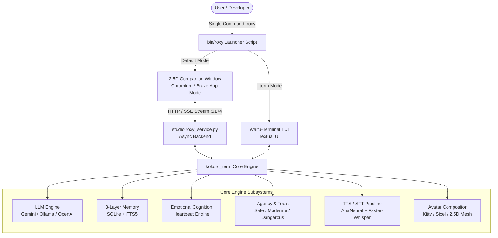
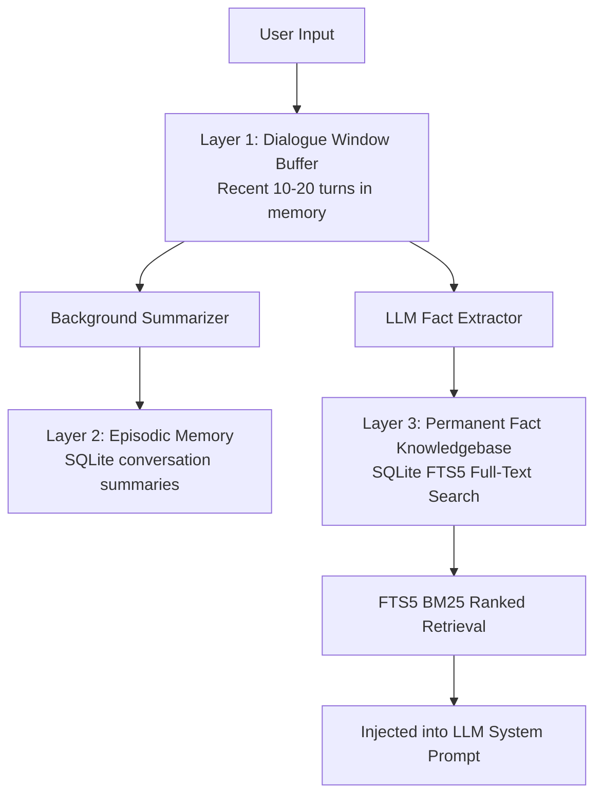

# 🌸 Roxy Migurdia Companion AI — Master Project Documentation

> **Complete Comprehensive Reference Manual & Architectural Blueprint**  
> **Repository**: [Midhunvvsggsg/roxy-companion](https://github.com/Midhunvvsggsg/roxy-companion)  
> **Primary Author & Maintainer**: Midhun (`Midhunvvsggsg`)  
> **Target OS**: Arch Linux (Hyprland / Wayland) & Cross-Platform (Windows)

---

## 1. Executive Summary & Vision

The **Roxy Migurdia Companion AI** is an open-source, resource-friendly, multimodal anime companion designed to live seamlessly on a developer's desktop. Built around the beloved character **Roxy Migurdia** (*Mushoku Tensei* — Water Saint-Class Magician), the companion blends technical developer utility with rich, immersive character interaction.

The project features a **dual-interface architecture**:
1. **🌟 2.5D Animated Studio & Companion Window (Standalone GUI)**: A frameless, transparent desktop companion with 2.5D layered mesh animations, Live2D-like depth, real-time voice, vision analysis, and microphone voice activity detection (VAD).
2. **🌸 Waifu-Terminal TUI (`kokoro-term`)**: An ultra-lightweight terminal interface using the Textual framework, featuring 24-bit half-block Unicode / Sixel / Kitty graphics protocol rendering, persistent memory, and system agency.



---

## 2. Complete Development Timeline & Stages

The project evolved across twelve distinct engineering stages:

```mermaid
flowchart LR
    S1[Stage 1: Core TUI & Engine] --> S2[Stage 2: Agency & Security]
    S2 --> S3[Stage 3: Multi-Protocol Rendering]
    S3 --> S4[Stage 4: Voice & Malayalam STT]
    S4 --> S5[Stage 5: Voice Audition Journey]
    S5 --> S6[Stage 6: Cel Repaint & Slicing]
    S6 --> S7[Stage 7: Emotional Cognition]
    S7 --> S8[Stage 8: Music Player & Ducking]
    S8 --> S9[Stage 9: Web Research Engine]
    S9 --> S10[Stage 10: 2.5D Mesh Studio]
    S10 --> S11[Stage 11: Single Launcher]
    S11 --> S12[Stage 12: GitHub Open Source]
```



### Stage 1: The Terminal Waifu Foundation
- Engineered the core Python application using Python 3.12 and Textual.
- Implemented character manifests (`character.yaml`, `voice.yaml`) defining Roxy's personality: Water Saint-Class Magician, devoted partner, playful mentor, proud yet easily flustered.
- Integrated pluggable LLM backends: Google Gemini 2.5 / 1.5, local Ollama (Llama 3, Qwen 2.5), and OpenAI-compatible endpoints.
- Designed 3-layer persistent memory: SQLite with FTS5 full-text search, short-term conversational context, and episodic background summarization.

### Stage 2: System Agency & Permission Security Governance
- Implemented real system interaction tools for Linux:
  - `system_info`: Hardware, CPU/RAM telemetry, active window context.
  - `file_ops`: Safe sandboxed reading, searching, and diff-based writing.
  - `packages`: Querying installed packages via `pacman`.
  - `media`: PipeWire/PulseAudio volume inspection and control.
  - `screen`: Wayland (`grim` / `slurp`) display screenshot capture.
- Designed a 3-tier security governance model:
  - `SAFE` (automatic execution without user prompt).
  - `MODERATE` (session approval requested).
  - `DANGEROUS` (explicit typed confirmation required).
- **In-Character Resistance**: When dangerous actions are requested, Roxy issues an in-character warning or objection ("Midhun, are you completely sure about running that?!"). Upon confirmation, she executes the task obediently. Full audit logging stored in `data/audit.log`.

### Stage 3: Multi-Protocol Visual Rendering
- Created a multi-backend terminal avatar compositor:
  - **Kitty Graphics Protocol**: Direct 32-bit RGBA hardware-accelerated image blitting.
  - **Sixel Protocol**: High-resolution rasterization for xterm/foot/wezterm.
  - **Half-Block Unicode (`▀▄`)**: 24-bit TrueColor pseudo-pixel rendering for universal compatibility in any terminal.
  - **ASCII Kaomoji**: Fallback for ultra-minimalist or headless environments.
- Implemented autonomous eye blinking, breathing oscillations, and speech-driven lip-sync mouth shape cycling (`mouth_closed`, `mouth_a`, `mouth_e`, `mouth_i`, `mouth_o`, `mouth_u`).

### Stage 4: Voice Input & Malayalam Speech Recognition
- Integrated `faster-whisper` for low-latency Speech-To-Text (STT).
- Implemented Voice Activity Detection (VAD) with RMS energy gating to filter background keyboard clatter and ambient noise.
- Engineered bilingual detection with native support for **Malayalam (മലയാളം)** and **Manglish**, enabling Roxy to understand queries in Midhun's native language and respond in English with her signature anime cadence.

### Stage 5: Voice Audition & Synthesis Evolution
- Conducted exhaustive voice auditions across multiple neural voice candidates:
  1. `Kokoro ONNX` (`af_whisper`): Lightweight local offline model, but lacked dramatic dub cadence.
  2. `en-US-AvaNeural`: Mature mommy/mentor tone.
  3. `en-US-AnaNeural`: High-pitched energetic teen tone.
  4. `en-US-JennyNeural`: Warm, expressive with breath pauses.
  5. `en-US-AriaNeural`: **The Winner.** Tuned to +3 Hz pitch with rapid +15% anime pacing. Captures an authentic English dub anime heroine cadence.
- Built a voice DSP processing pipeline: prosody chunking at commas/clauses, Japanese slang pronunciation mapping (`ara`, `fufu`, `mou`, `yosh`, `baka`), silence trimming, and peak audio limiter.

### Stage 6: Forensic Visual Cleanup & Cel-Shaded Repainting
- Extracted and segmented Roxy's 1024×1024 master cel art into discrete anatomical layers.
- Resolved visual defects:
  - Cel-repainted pale forehead region using polygon vector masks to eliminate scanline banding.
  - Synchronized hair bangs and front lock swaying.
  - Aligned eye highlight ball reflections to achieve < 1.5% facial symmetry error.
  - Generated transparent PNG sprites for expressions: neutral, happy, smile, blush, shy, serious, surprised, and half-lidded.

### Stage 7: Autonomous Emotional Cognition Layer
- Designed an asynchronous background cognitive engine (`kokoro_term/emotional/`):
  - `EmotionalState`: Tracks multi-dimensional vectors (affection, trust, mood, energy, stress, attachment).
  - `CognitionEngine`: Evaluates interaction history and generates internal monologues and autonomous reactions.
  - `Heartbeat`: Periodic tick updating emotional decay, absent-time drift, and spontaneous check-ins.

### Stage 8: Headless Music Player & Real-Data Guard
- Integrated background music streaming via `mpv` and `yt-dlp`.
- Engineered **Anti-Hallucination Real-Data Guard**: Enforces that the LLM cannot claim music is playing unless `mpv` has an active subprocess with confirmed playback telemetry.
- Implemented **Automatic Audio Ducking**: Dynamically lowers music volume whenever Roxy speaks and restores volume when she finishes.
- Added Bluetooth audio sink routing with PipeWire/WirePlumber compatibility.

### Stage 9: Resilient Multi-Source Web Research Engine
- Built a multi-provider live search interface with automatic fallback:
  - Primary: DuckDuckGo HTML & API scraper with anti-bot GET resilience.
  - Secondary: Brave Search API integration.
  - Caching layer: 10-minute in-memory query cache.
- Integrated UI article inspection panel for detailed reading.

### Stage 10: 2.5D Animated Companion Studio
- Bridged the Python engine with a web-based 2.5D mesh avatar studio (`studio/`):
  - Layered mesh deformers for 3D-like parallax head turning, breathing, eye-tracking, and blinking.
  - Built an async HTTP + Server-Sent Events (SSE) daemon (`studio/roxy_service.py`).
  - Implemented real-time audio streaming, live microphone VAD, and screen vision capture.

### Stage 11: Single-Command Unified Launcher (`roxy`)
- Developed `/home/midhun/.local/bin/roxy` and `bin/roxy`:
  - Automatically verifies and boots the Ollama/Gemini backend.
  - Starts the companion service on port `5174`.
  - Spawns a dedicated standalone application window (Chromium or Brave `--app` mode, 1280×750, transparent, frameless, no browser toolbars or tabs).
  - Supports `--term` flag for immediate TUI fallback.

### Stage 12: Clean Open-Source GitHub Release
- Prepared the codebase for public release:
  - Sanitized sensitive credentials (`.env` omitted, API keys safeguarded).
  - Untracked local SQLite databases and 200MB+ binary model files.
  - Structured the standalone `studio/` frontend bundle.
  - Initialized repository: `https://github.com/Midhunvvsggsg/roxy-companion`.

---

## 3. Subsystem Architecture Deep Dive

### 3.1 Core Engine & Configuration (`kokoro_term/`)
- `config.py`: Pydantic-based configuration management (`AppConfig`, `LLMConfig`, `VoiceConfig`, `AvatarConfig`, `AgentConfig`). Loads hierarchical settings from `config/default_config.yaml` and environment variables.
- `character.py`: Character loader parsing `character.yaml` and `voice.yaml`. Manages prompt interpolation, personality traits, and emotional state rules.
- `main.py`: Entrypoint initializing memory, tools, LLM providers, and mounting the Textual application.
- `perf.py`: Runtime telemetry tracking Time-To-First-Audio (TTFA), token generation speed, and memory consumption.

### 3.2 LLM Engine & Prompt Engineering (`kokoro_term/llm/`)
- Abstract base provider (`base.py`) with streaming token generators.
- `gemini.py`: High-speed streaming implementation using Google Gemini 2.5/1.5 Flash.
- `openai_compat.py`: Pluggable client for Ollama, LM Studio, vLLM, or OpenAI.
- **Emotion Tagging Protocol**: The LLM pre-appends every response with an emotion tag:
  ```text
  [emotion:smile] Yosh! Let us begin our lesson on water magic incantations!
  ```
  The UI and voice service parse and strip this tag to synchronously update the avatar's expression and voice pitch.

### 3.3 3-Layer Persistent Memory (`kokoro_term/memory/`)

- Contradiction resolution: Updates old facts when the user changes preferences (e.g., favorite framework, preferred name).
- Preferred name extraction: Permanently remembers user identity ("Midhun") while keeping phonetic TTS respelling separate.

### 3.4 Emotional Cognition & Relationship Engine (`kokoro_term/emotional/` & `kokoro_term/relationship/`)
- **Relationship State**: Tracks `affection` (0–100%), `trust` (0–100%), and `mood` (`Happy`, `Devoted`, `Flustered`, `Tsundere`, `Protective`).
- **Sliders**: Manages dynamic behavioral sliders (`tsundere_level`, `formality`, `shyness`, `possessiveness`).
- **Heartbeat Daemon**: Periodically evaluates interaction frequency; extended absence creates subtle longing or flustered greetings.

### 3.5 System Agency & Tool Ecosystem (`kokoro_term/tools/`)
The tool ecosystem gives Roxy real desktop management power:

| Tool Module | Key Capabilities | Permission Tier |
| :--- | :--- | :--- |
| `system_info.py` | CPU, RAM, disk usage, active desktop window, battery | `SAFE` |
| `file_ops.py` | Safe file search, directory inspection, file reading | `SAFE` |
| `file_ops.py` | File write/edit with unified diff preview | `MODERATE` |
| `packages.py` | Inspect installed Arch Linux packages (`pacman -Q`) | `SAFE` |
| `media.py` | Inspect volume, set volume, mute/unmute PipeWire sinks | `SAFE` |
| `music.py` | Search, queue, stream YouTube audio via headless mpv | `SAFE` |
| `screen.py` | Capture active monitor screenshot via `grim` | `MODERATE` |
| `screen.py` | Multimodal visual inspection of screen via Gemini Vision | `MODERATE` |
| `shell.py` | Execute shell commands (with in-character resistance) | `DANGEROUS` |
| `reminder.py` | Asynchronous timers and notification alerts | `SAFE` |
| `web_research.py` | Live web search with DuckDuckGo / Brave and article parsing | `SAFE` |

### 3.6 Voice Synthesis & DSP Pipeline (`kokoro_term/tts/`)
- **Edge-TTS Provider (`edge_provider.py`)**: Uses Microsoft's cloud neural synthesis (`en-US-AriaNeural`).
- **Pitch & Speed Modulation**:
  - Base Speed: `1.15x`
  - Base Pitch: `+3 Hz`
  - Emotion-dependent pitch shifts (`teasing: +6`, `flustered: +10`, `blush: +8`, `serious: -2`).
- **Japanese Slang Engine**: Detects anime phrases (`ara`, `fufu`, `mou`, `yosh`, `sugoi`, `baka`, `ganbatte`) and maps phonetic respelling to preserve authentic Japanese pronunciation on English neural voices.

### 3.7 2.5D Animated Studio & Companion Service (`studio/`)
- `studio/roxy_service.py`: High-performance asynchronous daemon providing:
  - `POST /api/chat`: Streaming SSE chat with memory and relationship integration.
  - `GET /api/tts`: Audio synthesis with lipsync cues.
  - `POST /api/screen/capture` & `/api/screen/analyze`: Real-time screen analysis.
  - `GET /api/mic/level` & `POST /api/mic/stop`: Voice recording with VAD.
- `studio/projects/roxy/`:
  - `built/`: Layer PNGs (`base.png`, `hair.png`, `eye0_ball.png`, `eye0_lash.png`, `eye0_crease.png`, `hairmask.png`).
  - `rig.json`: Mesh vertices, skinning weights, and deformation physics (hair sway, eye blink, mouth open).
- `studio/dist/companion.html`: Web-based rendering viewport using WebGL mesh shaders and CSS layout.

---

## 4. Repository File & Directory Manifest

```text
roxy-companion/
├── .env.example                       <- Sample environment variable configuration
├── .gitignore                         <- Comprehensive security & build exclusion rules
├── .python-version                    <- Pinned Python runtime (3.12)
├── pyproject.toml                     <- Project manifest & dependencies (hatchling build)
├── uv.lock                            <- Pinned reproducible dependency lockfile
├── README.md                          <- Main public documentation & quickstart
│
├── bin/
│   └── roxy                           <- Portable single-command launcher script
│
├── characters/
│   └── roxy/
│       ├── character.yaml             <- Roxy personality traits, bio, and speaking style rules
│       ├── voice.yaml                 <- Voice engine, pitch, slang, and prosody parameters
│       └── avatar/
│           ├── base.png               <- Master high-res body cel sprite
│           ├── forehead_masks.json    <- Coordinate polygon vector masks for cel repaint
│           ├── manifest.yaml          <- Z-index layering & offset definitions
│           ├── roxy_terminal.mp4      <- Terminal video loop
│           └── layers/                <- Discrete sprite layers (blush, sweat, eyes, brows, mouth)
│
├── assets_in/
│   └── roxy/                          <- Master un-sliced RGBA expression sheets
│
├── config/
│   └── default_config.yaml            <- System configuration (LLM, memory, tools, audio)
│
├── kokoro_term/                       <- Core AI companion Python package
│   ├── __init__.py
│   ├── __main__.py                    <- Enables `python -m kokoro_term`
│   ├── main.py                        <- Application initialization & loop
│   ├── character.py                   <- Character & voice profile manager
│   ├── config.py                      <- Pydantic configuration schemas
│   ├── perf.py                        <- Latency & TTFA telemetry recorder
│   ├── wizard.py                      <- Interactive first-time setup wizard
│   │
│   ├── llm/                           <- Pluggable LLM engines
│   │   ├── base.py                    <- Abstract streaming LLM client
│   │   ├── factory.py                 <- Engine instantiation factory
│   │   ├── gemini.py                  <- Google Gemini Flash streaming client
│   │   └── openai_compat.py           <- Ollama / OpenAI streaming client
│   │
│   ├── memory/                        <- 3-Layer persistent memory subsystem
│   │   └── manager.py                 <- SQLite + FTS5 full-text search & extraction
│   │
│   ├── emotional/                     <- Autonomous emotional cognition
│   │   ├── state.py                   <- Vector state (affection, trust, stress, energy)
│   │   ├── cognition.py               <- Cognitive appraisal & internal monologue
│   │   └── heartbeat.py               <- Periodic emotional decay & tick loop
│   │
│   ├── relationship/                  <- Relationship evolution
│   │   └── models.py                  <- Relationship stage & personality sliders
│   │
│   ├── tools/                         <- System agency & tool execution
│   │   ├── agent.py                   <- Multi-step autonomous agent loop
│   │   ├── registry.py                <- Tool registration decorator & catalog
│   │   ├── permission.py              <- SAFE / MODERATE / DANGEROUS governance
│   │   ├── resistance.py              <- In-character tsundere resistance
│   │   ├── audit.py                   <- Security audit logger
│   │   ├── music.py                   <- Headless mpv background music manager
│   │   └── builtin/                   <- System interaction tool implementations
│   │       ├── file_ops.py            <- Sandboxed filesystem tools
│   │       ├── system_info.py         <- Hardware & OS telemetry
│   │       ├── packages.py            <- Package manager integration
│   │       ├── media.py               <- Audio volume & sink inspection
│   │       ├── screen.py              <- Wayland display screenshot capture
│   │       ├── shell.py               <- Guarded command execution
│   │       ├── reminder.py            <- Asynchronous timers & alarms
│   │       └── web_research.py        <- DuckDuckGo & Brave live search engine
│   │
│   ├── tts/                           <- Voice synthesis & audio processing
│   │   ├── base.py                    <- Abstract TTS provider interface
│   │   ├── manager.py                 <- Unified speech synthesizer & router
│   │   ├── edge_provider.py           <- Microsoft cloud neural TTS (AriaNeural)
│   │   ├── local_provider.py          <- Kokoro ONNX offline TTS
│   │   ├── speech_style.py            <- Japanese anime slang & pronunciation rules
│   │   └── audio_processor.py         <- Silence trimming, F0 measurement, limiter
│   │
│   ├── stt/                           <- Speech recognition
│   │   └── whisper_provider.py        <- Faster-Whisper with VAD & Malayalam hints
│   │
│   ├── avatar/                        <- Terminal avatar compositor
│   │   ├── compositor.py              <- Dynamic multi-layer sprite merger
│   │   ├── animation.py               <- Breathing, blinking, and lipsync state machine
│   │   └── backends/                  <- Hardware display backends
│   │       ├── base.py                <- Protocol interface
│   │       ├── kitty_backend.py       <- Kitty graphics protocol
│   │       ├── sixel_backend.py       <- Sixel protocol rasterizer
│   │       ├── halfblock_backend.py   <- Universal 24-bit Unicode blocks
│   │       └── window_backend.py      <- Floating PySide overlay window
│   │
│   └── ui/                            <- Terminal user interface
│       ├── app.py                     <- Textual TUI layout, widgets, & chat stream
│       └── components/                <- Custom Textual widgets
│
├── studio/                            <- 2.5D Animated Studio & Companion Frontend
│   ├── companion.html                 <- Main HTML entrypoint for companion app
│   ├── roxy_service.py                <- Async Aiohttp companion server & API
│   ├── reprocess_avatar_visuals.py    <- Facial symmetry & cel-repaint utility
│   ├── roxy_transparent.png           <- Master high-res avatar portrait
│   ├── dist/                          <- Compiled web companion bundle & assets
│   ├── projects/roxy/                 <- 2.5D Avatar mesh rig, layers, & config
│   │   ├── rig.json                   <- Mesh deformation & bone physics
│   │   └── built/                     <- Layer PNGs & layers.json
│   └── src/live/                      <- Frontend TypeScript & CSS sources
│
├── docs/
│   └── making_sprite_packs.md         <- Specification guide for custom characters
│
├── scripts/
│   ├── make_placeholder_roxy.py       <- Automated sprite pack generator
│   └── slice_expressions.py           <- Expression sheet slicing utility
│
└── tests/                             <- Automated pytest test suite
    ├── test_config.py                 <- Configuration schema & env var tests
    ├── test_emotional_layer.py        <- Emotional cognition & vector drift tests
    └── test_part3_music.py            <- Music playback & anti-hallucination tests
```

---

## 5. Operational Commands & Guide

### 5.1 Launching Roxy

```bash
# Mode 1: Launch 2.5D Animated Desktop Window (Default)
./bin/roxy

# Mode 2: Launch Terminal Waifu TUI
./bin/roxy --term
# Or directly via Python package:
uv run kokoro-term
```

### 5.2 Terminal TUI Slash Commands

| Slash Command | Function |
| :--- | :--- |
| `/status` | Displays relationship stage, affection, trust, and personality sliders |
| `/status set <slider> <val>`| Manually adjust any slider (e.g. `/status set affection 95`) |
| `/status reset` | Restores relationship metrics to character defaults |
| `/memory show` | Lists active persistent user facts and episodic summaries |
| `/memory forget <term>` | Removes a specific fact from permanent SQLite storage |
| `/memory export [file]` | Exports all memory to a structured Markdown document |
| `/memory wipe` | Completely wipes memory for the current companion |
| `/tools` | Lists all registered tools, descriptions, and permission tiers |
| `/audit` | Dumps recent security audit log entries |
| `/perf` | Displays live telemetry (RSS memory, DB size, TTFA latency) |
| `/clear` | Clears chat display viewport |
| `/quit` | Exits the application cleanly |

### 5.3 Environment Variables

| Variable | Description |
| :--- | :--- |
| `GEMINI_API_KEY` | API key for Google Gemini (Primary multimodal LLM) |
| `OPENAI_API_KEY` | API key for OpenAI / compatible endpoints |
| `BRAVE_API_KEY` | Optional API key for Brave Search API |
| `KOKORO_DIR` | Custom override path for the companion repository |

---

## 6. Project Architecture Summary

```text
+--------------------------------------------------------------------------------+
|                         ROXY COMPANION AI ARCHITECTURE                         |
+--------------------------------------------------------------------------------+
|  [PRESENTATION LAYER]                                                          |
|    - 2.5D Animated Studio Window (Frameless Chromium/Brave WebGL Mesh App)     |
|    - Terminal Waifu TUI (Textual + Sixel / Kitty / Half-Block Unicode)         |
+--------------------------------------------------------------------------------+
|  [SERVICE & API LAYER]                                                         |
|    - Async Aiohttp Daemon (:5174) with Streaming SSE                           |
|    - Real-Time Lipsync Cues, Screen Capture & Vision Analysis                  |
+--------------------------------------------------------------------------------+
|  [COGNITIVE & MEMORY LAYER]                                                    |
|    - Emotional Cognition Engine (Affection, Trust, Mood, Autonomous Heartbeat) |
|    - 3-Layer Persistent Memory (SQLite + FTS5 BM25 Full-Text Search)           |
+--------------------------------------------------------------------------------+
|  [AGENCY & VOICE PIPELINE]                                                     |
|    - Multi-Tier System Agency with In-Character Resistance                     |
|    - Neural Speech Synthesis (en-US-AriaNeural + Japanese Slang DSP)           |
|    - Faster-Whisper Speech-To-Text with Malayalam / Manglish VAD               |
+--------------------------------------------------------------------------------+
```
